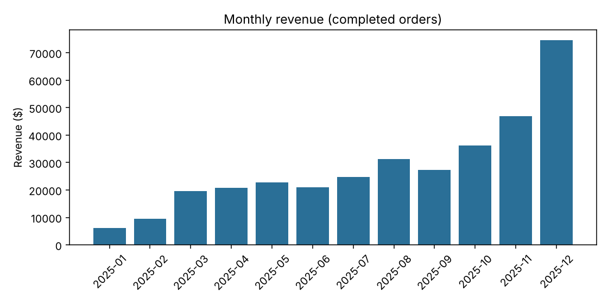
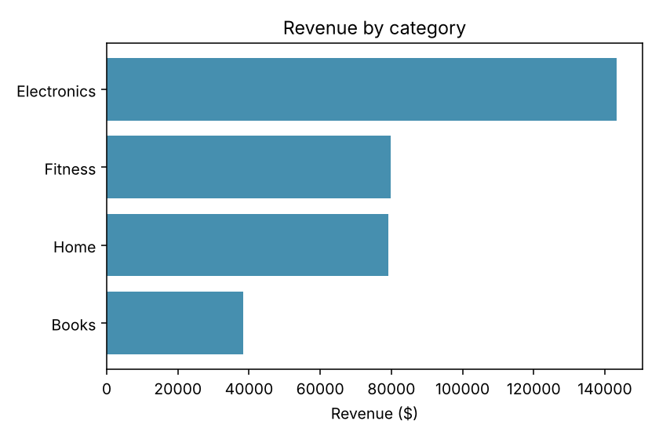
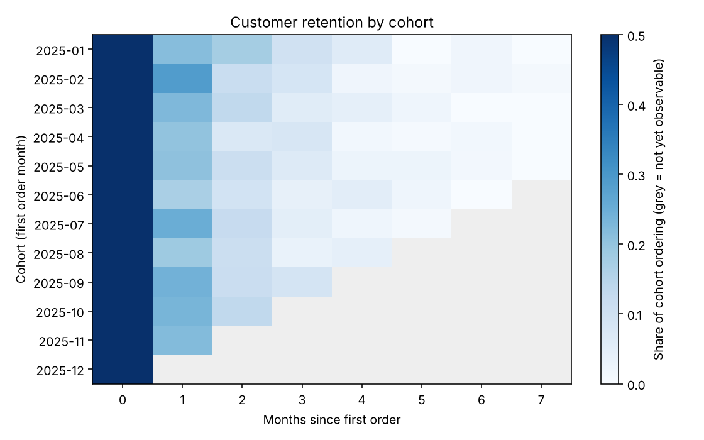
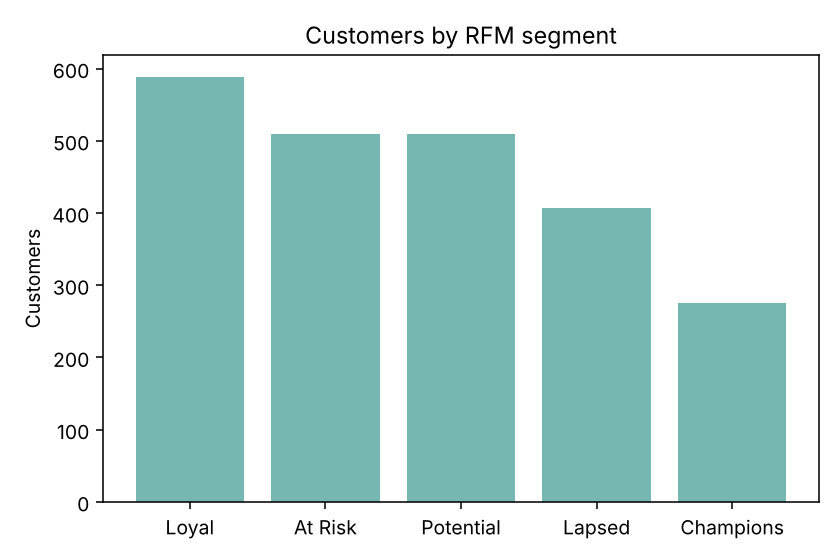

# Findings

All figures are computed from the synthetic dataset by `run_analysis.py`.

## Data cleaning

- rows raw: 6270
- duplicate rows removed: 153
- unparseable dates dropped: 0
- missing country filled unknown: 188
- invalid quantity rows dropped: 63
- invalid price rows dropped: 0
- rows clean: 6054

## Headline KPIs (completed orders)

- Revenue: $340,643.50 across 3,715 orders and 2,289 customers
- Average order value: $91.69
- Repeat customer rate: 42.6%

## What the data shows

- **Seasonality:** 2025-12 was the strongest month ($74,540) and 2025-01 the weakest ($6,218). November and December together account for 36% of annual revenue.
- **Category mix:** Electronics leads with 42.1% of revenue.
- **Top product:** Smart Watch ($79,715).
- **Geography:** United States generates the most revenue ($177,828).
- **Returns and cancellations:** completed 89.2%, cancelled 6.5%, returned 4.3% of orders.
- **Retention:** on average 22.2% of a cohort orders again in the month after their first order.
- **RFM segments:** Loyal 589, At Risk 509, Potential 509, Lapsed 407, Champions 275. Champions drive 25% of customer revenue.

## Charts

